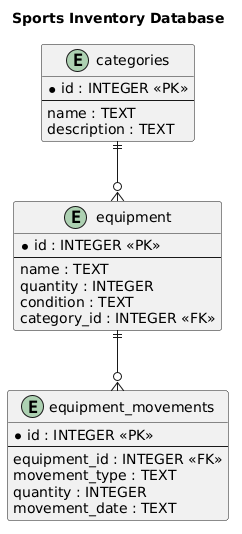

# Учёт спортивного инвентаря в зале

## Описание проекта

Проект «Учёт спортивного инвентаря в зале» предназначен для хранения информации о спортивном оборудовании, контроля его количества и учёта поступления и выдачи инвентаря.

Проект разрабатывается на языке Python в рамках лабораторных работ. В процессе разработки изучаются основы программирования, организация структуры проекта, работа с базами данных, создание диаграмм и использование Git и GitHub.

На текущем этапе создана структура базы данных SQLite, добавлены тестовые записи и разработана ER-диаграмма.

## Предметная область

Предметная область проекта — учёт спортивного инвентаря, используемого в спортивном зале.

В спортивном зале может находиться различное оборудование: гантели, гири, мячи, скакалки, коврики и другие спортивные принадлежности. Для эффективной организации работы необходимо хранить информацию об инвентаре, знать его количество и состояние, а также учитывать поступление и выдачу оборудования.

Автоматизация учёта позволяет упростить работу с информацией, уменьшить вероятность ошибок при ведении записей и облегчить контроль за спортивным инвентарём.

Основные объекты предметной области:

- **Категория** — группа спортивного инвентаря, например мячи или гантели.
- **Спортивный инвентарь** — конкретный вид оборудования, его количество и состояние.
- **Движение инвентаря** — запись о поступлении или выдаче оборудования.
- **Количество** — число единиц определённого вида инвентаря.

## Возможности проекта

На текущем этапе реализованы:

- создание базы данных SQLite;
- создание таблиц для хранения категорий, инвентаря и записей о его перемещении;
- установление связей между таблицами с помощью внешних ключей;
- добавление тестовых записей;
- вывод содержимого таблиц в терминал для проверки работы базы данных.

В дальнейшем планируется реализовать:

- просмотр списка спортивного инвентаря;
- добавление новых записей;
- изменение информации об инвентаре;
- удаление записей;
- поиск оборудования;
- контроль количества и состояния инвентаря;
- учёт поступления и выдачи оборудования.

## Архитектура проекта

Проект использует простую модульную архитектуру.

Основные компоненты:

1. **Главный файл программы** — точка входа в приложение.
2. **Модуль работы с базой данных** — создание базы данных, таблиц и добавление тестовых записей.
3. **SQL-схема** — описание структуры таблиц, полей, ключей и связей.
4. **База данных SQLite** — хранение информации о категориях, спортивном инвентаре и его перемещениях.
5. **Документация и диаграммы** — описание проекта и наглядное представление его структуры.

На данном этапе реализована работа с базой данных и проверочный вывод информации. Полноценный пользовательский интерфейс и все функции учёта ещё предстоит разработать.

## Диаграммы проекта

### Диаграмма вариантов использования (Use Case)

Диаграмма показывает взаимодействие сотрудника спортивного зала с системой учёта спортивного инвентаря.


### ER-диаграмма базы данных

ER-диаграмма отражает структуру базы данных, основные атрибуты таблиц, первичные и внешние ключи, а также связи между категориями, спортивным инвентарём и записями о его перемещении.



## Структура проекта

```text
sports_inventory/
├── main.py
├── database.py
├── README.md
├── database/
│   ├── schema.sql
│   └── sports_inventory.db
└── docs/
    └── diagrams/
        ├── use_case.png
        ├── use_case.puml
        ├── er_diagram.puml
        └── er_diagrams.png
```

Назначение файлов и каталогов:

- `main.py` — основной файл запуска программы.
- `database.py` — Python-модуль для создания базы данных, выполнения SQL-схемы, добавления тестовых записей и вывода результатов.
- `README.md` — документация проекта.
- `database/` — каталог файлов базы данных.
- `schema.sql` — SQL-скрипт создания таблиц и связей между ними.
- `sports_inventory.db` — файл базы данных SQLite.
- `docs/diagrams/` — каталог диаграмм проекта.
- `use_case.png` — изображение диаграммы вариантов использования.
- `use_case.puml` — исходный код диаграммы вариантов использования, если он сохранён в проекте.
- `er_diagram.puml` — исходный код ER-диаграммы.
- `er_diagrams.png` — изображение ER-диаграммы.

## Структура базы данных

База данных `sports_inventory.db` создана с использованием SQLite. Она включает три таблицы.

### Таблица `categories`

Содержит категории спортивного инвентаря.

| Поле | Тип данных | Назначение |
|---|---|---|
| `id` | INTEGER | Первичный ключ, идентификатор категории |
| `name` | TEXT | Название категории |
| `description` | TEXT | Описание категории |

### Таблица `equipment`

Содержит сведения о спортивном инвентаре.

| Поле | Тип данных | Назначение |
|---|---|---|
| `id` | INTEGER | Первичный ключ, идентификатор предмета |
| `name` | TEXT | Название инвентаря |
| `quantity` | INTEGER | Количество единиц |
| `condition` | TEXT | Состояние инвентаря |
| `category_id` | INTEGER | Внешний ключ категории |

### Таблица `equipment_movements`

Содержит записи о движении спортивного инвентаря.

| Поле | Тип данных | Назначение |
|---|---|---|
| `id` | INTEGER | Первичный ключ записи |
| `equipment_id` | INTEGER | Внешний ключ инвентаря |
| `movement_type` | TEXT | Тип операции: поступление или выдача |
| `quantity` | INTEGER | Количество перемещённых предметов |
| `movement_date` | TEXT | Дата операции |

### Связи между таблицами

- `categories` → `equipment`: связь «один ко многим» (1:N). Одна категория может включать несколько видов инвентаря.
- `equipment` → `equipment_movements`: связь «один ко многим» (1:N). Для одного вида инвентаря может храниться несколько записей о его перемещении.

Первичные ключи (`PRIMARY KEY`) обеспечивают идентификацию записей, а внешние ключи (`FOREIGN KEY`) связывают данные между таблицами.

## Основные компоненты

### `main.py`

Главный файл проекта, содержащий точку входа в программу.

### `database.py`

Модуль работы с SQLite. Он подключается к базе данных, читает SQL-схему из `schema.sql`, создаёт таблицы, добавляет тестовые данные и выводит содержимое таблиц в терминал.

Для работы с базой данных используется стандартный модуль Python `sqlite3`.

### `database/schema.sql`

SQL-скрипт, содержащий команды `CREATE TABLE`, определения полей, первичных и внешних ключей.

### `database/sports_inventory.db`

Файл, в котором хранится база данных проекта.

### `docs/diagrams/`

Каталог с изображениями диаграмм и их исходными файлами.

## Используемые технологии

- **Python** — язык программирования.
- **SQLite** — система управления базой данных.
- **SQL** — язык создания таблиц и работы с данными.
- **sqlite3** — стандартный модуль Python для работы с SQLite.
- **Visual Studio Code** — среда разработки.
- **Git** — система контроля версий.
- **GitHub** — платформа для хранения и публикации репозитория.
- **Markdown** — формат оформления документации.
- **PlantUML** — инструмент создания диаграмм.

## Запуск программы

Для работы с проектом необходимо установить Python и открыть папку проекта в Visual Studio Code.

### Запуск основного файла

В терминале из корневой папки проекта выполните:

```bash
python main.py
```

### Создание базы данных и добавление тестовых записей

Выполните команду:

```bash
python database.py
```

Модуль создаёт базу данных и таблицы, добавляет тестовые записи и выводит содержимое таблиц в терминал.

В проекте используются следующие тестовые данные:

- категории «Мячи» и «Гантели»;
- инвентарь «Футбольный мяч» и «Гантели 5 кг»;
- запись о поступлении футбольных мячей.

Повторный запуск скрипта не должен создавать повторные тестовые категории, предметы инвентаря и соответствующую тестовую запись о перемещении.

## Контроль версий

Для контроля изменений используется Git. Локальный репозиторий связан с удалённым репозиторием на GitHub.

Основные команды:

```bash
git status
git add -A
git commit -m "Update project"
git push
```

Эти команды позволяют проверить состояние файлов, подготовить изменения, сохранить новую версию проекта и отправить её на GitHub.

## Заключение

В рамках разработки проекта «Учёт спортивного инвентаря в зале» подготовлена структура проекта, настроен контроль версий, создана документация и разработана база данных SQLite.

Созданы три таблицы: `categories`, `equipment` и `equipment_movements`. Для них определены поля, типы данных, первичные и внешние ключи, а также связи между таблицами. Добавлены тестовые записи, проверена работа базы данных и подготовлена ER-диаграмма.

В дальнейшем планируется реализовать полноценные функции учёта, чтобы программа могла использоваться для хранения, поиска и обработки информации о спортивном оборудовании.
