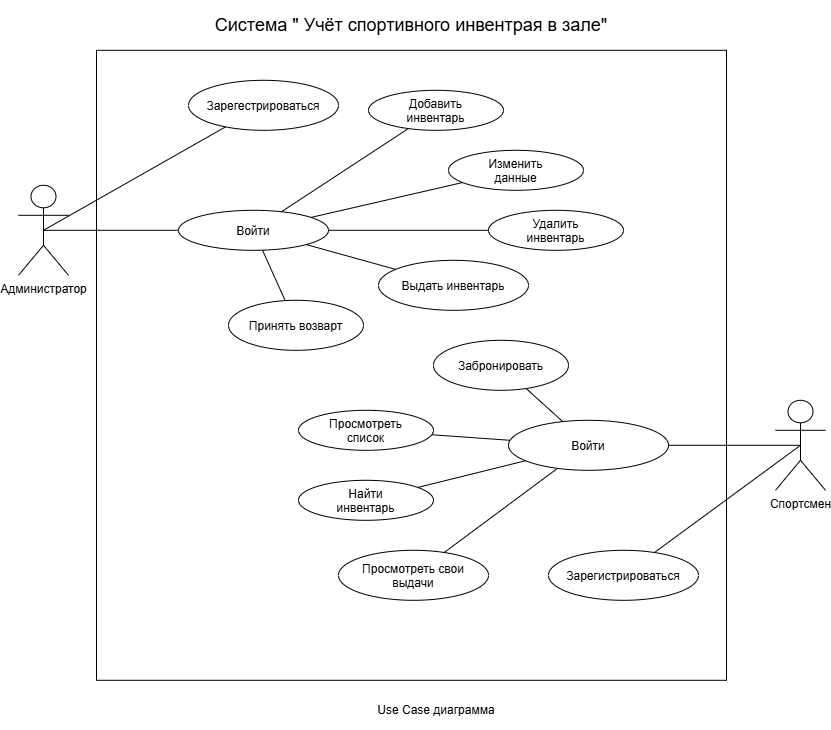
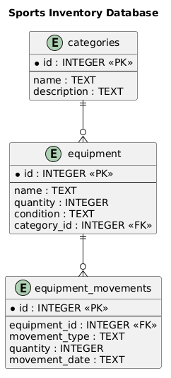

# Учёт спортивного инвентаря в зале

## Описание проекта

Проект «Учёт спортивного инвентаря в зале» предназначен для хранения информации о спортивном оборудовании, контроля его количества и состояния, а также учёта поступления и списания инвентаря.

Проект разрабатывается на языке Python в рамках лабораторных работ. В процессе разработки изучаются основы программирования, организация структуры проекта, работа с базами данных, создание диаграмм и использование Git и GitHub.

На текущем этапе создана база данных SQLite, разработана модульная структура приложения, реализованы регистрация и авторизация пользователей, разграничение прав доступа, а также основные функции работы со спортивным инвентарём.

## Предметная область

Предметная область проекта — учёт спортивного инвентаря, используемого в спортивном зале.

В спортивном зале может находиться различное оборудование: гантели, гири, мячи, скакалки, коврики и другие спортивные принадлежности. Для эффективной организации работы необходимо хранить информацию об инвентаре, знать его количество и состояние, а также учитывать поступление и списание оборудования.

Автоматизация учёта позволяет упростить работу с информацией, уменьшить вероятность ошибок при ведении записей и облегчить контроль за спортивным инвентарём.

Основные объекты предметной области:

- **Категория** — группа спортивного инвентаря, например мячи или гантели.
- **Спортивный инвентарь** — конкретный вид оборудования, его количество и состояние.
- **Движение инвентаря** — запись о поступлении или списании оборудования.
- **Пользователь** — зарегистрированный участник системы с определённой ролью.

## Возможности проекта

На текущем этапе реализованы:

- создание базы данных SQLite и необходимых таблиц;
- установление связей между таблицами с помощью внешних ключей;
- добавление начальных тестовых записей;
- регистрация новых пользователей;
- авторизация по логину и паролю;
- хеширование паролей пользователей;
- разделение пользователей на две роли: администратор и обычный пользователь;
- просмотр списка категорий;
- просмотр спортивного инвентаря;
- просмотр истории операций;
- добавление нового инвентаря администратором;
- удаление инвентаря администратором;
- проверка вводимых данных;
- проверка прав доступа при выполнении административных операций;
- учёт поступления и списания инвентаря через сервисный модуль.

## Архитектура проекта

Проект использует модульную многоуровневую архитектуру.

Основные компоненты:

1. **Главный файл программы** — точка входа в приложение, запуск базы данных и переход к авторизации.
2. **Модуль работы с базой данных** — подключение к SQLite, создание таблиц и добавление начальных записей.
3. **Модели (Models)** — описание объектов предметной области с использованием dataclass.
4. **Репозитории (Repositories)** — выполнение SQL-запросов и взаимодействие с базой данных.
5. **Сервисы (Services)** — основная логика программы, проверка данных, прав доступа и взаимодействие с репозиториями.
6. **Пользовательский интерфейс (UI)** — консольное меню, регистрация и авторизация.
7. **Документация и диаграммы** — описание проекта и наглядное представление его структуры.

Взаимодействие компонентов происходит по следующей схеме:

```text
Пользователь
     ↓
    UI
     ↓
  Services
     ↓
Repositories
     ↓
   SQLite
```

Такое разделение позволяет упростить разработку, проверку и дальнейшее изменение программы.

## Диаграммы проекта

### Диаграмма вариантов использования (Use Case)

Диаграмма показывает взаимодействие пользователя и администратора с системой учёта спортивного инвентаря.



### ER-диаграмма базы данных

ER-диаграмма отражает структуру базы данных, основные атрибуты таблиц, первичные и внешние ключи, а также связи между категориями, спортивным инвентарём, пользователями и записями о его перемещении.



## Структура проекта

```text
sports_inventory/
├── main.py
├── database.py
├── README.md
│
├── database/
│   ├── schema.sql
│   └── sports_inventory.db
│
├── models/
│   ├── category.py
│   ├── equipment.py
│   ├── movement.py
│   └── user.py
│
├── repositories/
│   ├── category_repository.py
│   ├── equipment_repository.py
│   ├── movement_repository.py
│   └── user_repository.py
│
├── services/
│   ├── category_service.py
│   ├── equipment_service.py
│   ├── movement_service.py
│   └── auth_service.py
│
├── ui/
│   ├── auth.py
│   └── menu.py
│
└── docs/
    └── diagrams/
        ├── use_case.png
        ├── use_case.puml
        ├── er_diagram.puml
        └── er_diagrams.png
```

Назначение основных каталогов и файлов:

- `main.py` — основной файл запуска программы.
- `database.py` — подключение к базе данных, создание таблиц и добавление начальных записей.
- `database/` — каталог файлов базы данных.
- `schema.sql` — SQL-скрипт создания таблиц и связей между ними.
- `sports_inventory.db` — файл базы данных SQLite.
- `models/` — каталог моделей данных.
- `repositories/` — каталог классов для выполнения операций с базой данных.
- `services/` — каталог сервисов с основной логикой программы.
- `ui/` — каталог пользовательского интерфейса и авторизации.
- `docs/diagrams/` — каталог диаграмм проекта.
- `README.md` — документация проекта.

## Структура базы данных

База данных `sports_inventory.db` создана с использованием SQLite. Она включает четыре таблицы.

### Таблица `categories`

Содержит категории спортивного инвентаря.

| Поле | Тип данных | Назначение |
|---|---|---|
| `id` | INTEGER | Первичный ключ, идентификатор категории |
| `name` | TEXT | Название категории |
| `description` | TEXT | Описание категории |

### Таблица `equipment`

Содержит сведения о спортивном инвентаре.

| Поле | Тип данных | Назначение |
|---|---|---|
| `id` | INTEGER | Первичный ключ, идентификатор предмета |
| `name` | TEXT | Название инвентаря |
| `quantity` | INTEGER | Количество единиц |
| `condition` | TEXT | Состояние инвентаря |
| `category_id` | INTEGER | Внешний ключ категории |

### Таблица `equipment_movements`

Содержит записи о движении спортивного инвентаря.

| Поле | Тип данных | Назначение |
|---|---|---|
| `id` | INTEGER | Первичный ключ записи |
| `equipment_id` | INTEGER | Внешний ключ инвентаря |
| `movement_type` | TEXT | Тип операции: поступление или списание |
| `quantity` | INTEGER | Количество перемещённых предметов |
| `movement_date` | TEXT | Дата операции |

### Таблица `users`

Содержит информацию о зарегистрированных пользователях.

| Поле | Тип данных | Назначение |
|---|---|---|
| `id` | INTEGER | Первичный ключ пользователя |
| `login` | TEXT | Логин пользователя |
| `password_hash` | TEXT | Хеш пароля |
| `role` | TEXT | Роль пользователя |

### Связи между таблицами

- `categories` → `equipment`: связь «один ко многим» (1:N). Одна категория может включать несколько видов инвентаря.
- `equipment` → `equipment_movements`: связь «один ко многим» (1:N). Для одного вида инвентаря может храниться несколько записей о его перемещении.
- Таблица `users` хранит учётные записи пользователей системы.

Первичные ключи (`PRIMARY KEY`) обеспечивают идентификацию записей, а внешние ключи (`FOREIGN KEY`) связывают данные между таблицами.

## Основные компоненты

### `main.py`

Главный файл проекта. Запускает создание базы данных, вызывает меню авторизации и после успешного входа открывает главное меню пользователя.

### `database.py`

Модуль работы с SQLite. Он подключается к базе данных, читает SQL-схему из `schema.sql`, создаёт таблицы и добавляет начальные тестовые данные.

Для работы с базой данных используется стандартный модуль Python `sqlite3`.

### `database/schema.sql`

SQL-скрипт, содержащий команды `CREATE TABLE`, определения полей, первичных и внешних ключей.

### `models/`

Содержит модели данных, созданные с помощью `dataclass`. Каждая модель соответствует одной из таблиц базы данных: категория, инвентарь, движение инвентаря или пользователь.

### `repositories/`

Содержит классы для работы с таблицами базы данных. В репозиториях реализованы основные CRUD-операции: добавление, получение, изменение и удаление записей.

### `services/`

Содержит основную логику приложения. Сервисы выполняют проверку данных, проверку существования записей, контроль прав доступа и взаимодействуют с репозиториями.

### `ui/`

Содержит консольный интерфейс программы. Модуль `auth.py` отвечает за регистрацию и авторизацию, а `menu.py` — за главное меню и взаимодействие с пользователем.

### `docs/diagrams/`

Каталог с изображениями диаграмм и их исходными файлами.

## Используемые технологии

- **Python** — язык программирования.
- **SQLite** — система управления базой данных.
- **SQL** — язык создания таблиц и работы с данными.
- **sqlite3** — стандартный модуль Python для работы с SQLite.
- **dataclasses** — создание моделей данных.
- **hashlib** — хеширование паролей.
- **Visual Studio Code** — среда разработки.
- **Git** — система контроля версий.
- **GitHub** — платформа для хранения и публикации репозитория.
- **Markdown** — формат оформления документации.
- **PlantUML** — инструмент создания диаграмм.

## Запуск программы

Для работы с проектом необходимо установить Python и открыть папку проекта в Visual Studio Code.

### Запуск основного файла

В терминале из корневой папки проекта выполните:

```bash
python main.py
```

При запуске программа создаёт необходимые таблицы базы данных и добавляет начальные записи, если они ещё отсутствуют.

После этого появляется меню авторизации, в котором можно войти в существующий аккаунт, зарегистрироваться или завершить работу программы.

### Регистрация и авторизация

Для создания нового аккаунта необходимо выбрать пункт «Зарегистрироваться», ввести логин и пароль.

После регистрации пользователь получает роль `user`.

Для входа в систему необходимо выбрать пункт «Войти» и ввести данные зарегистрированного аккаунта.

Административные права назначаются отдельно.

### Создание базы данных и добавление тестовых записей

При необходимости базу данных можно создать отдельно с помощью команды:

```bash
python database.py
```

Модуль создаёт таблицы, добавляет начальные записи и выводит содержимое таблиц в терминал.

В проекте используются следующие начальные данные:

- категории «Мячи» и «Гантели»;
- инвентарь «Футбольный мяч» и «Гантели 5 кг»;
- начальная запись о поступлении футбольных мячей.

Повторный запуск не должен создавать новые копии начальных записей, если они уже существуют.

## Контроль версий

Для контроля изменений используется Git. Локальный репозиторий связан с удалённым репозиторием на GitHub.

Основные команды:

```bash
git status
git add -A
git commit -m "Update project"
git push
```

Эти команды позволяют проверить состояние файлов, подготовить изменения, сохранить новую версию проекта и отправить её на GitHub.

## Заключение

В рамках разработки проекта «Учёт спортивного инвентаря в зале» создано консольное приложение на языке Python с использованием базы данных SQLite.

Реализованы четыре таблицы: `categories`, `equipment`, `equipment_movements` и `users`. Созданы модели данных, репозитории для взаимодействия с базой данных и сервисы для выполнения основной логики приложения.

Также реализованы регистрация и авторизация пользователей, разграничение прав доступа, просмотр категорий, инвентаря и истории операций, а также добавление и удаление спортивного инвентаря администратором.

Проект демонстрирует применение модульной архитектуры, работу с базами данных, использование CRUD-операций и организацию взаимодействия между отдельными уровнями приложения.